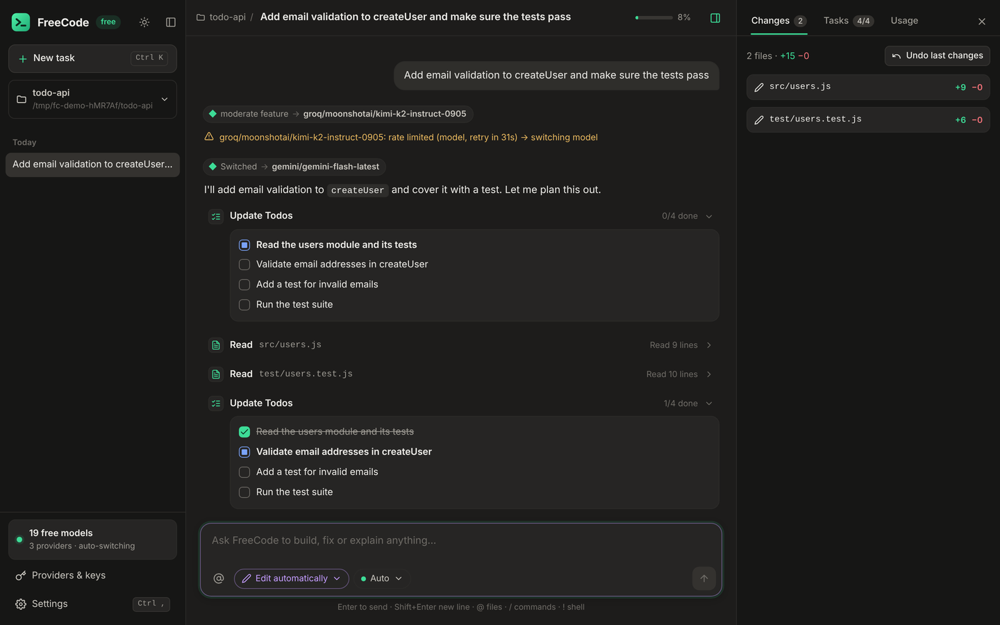
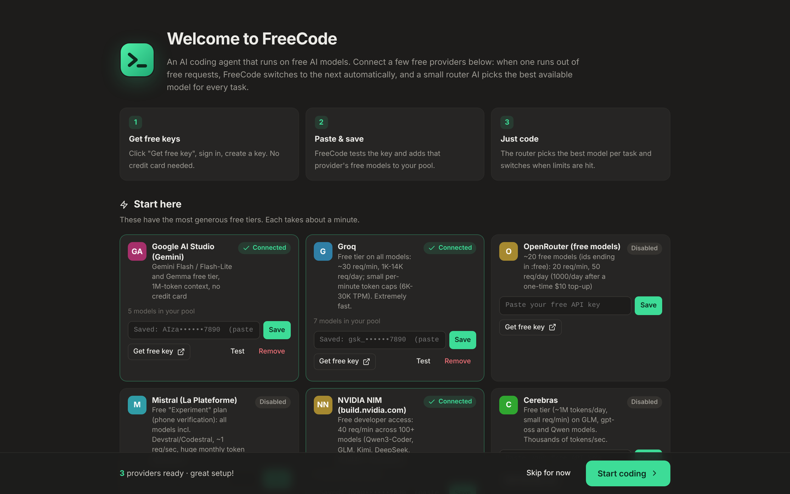

# FreeCode

**A free AI coding agent with a desktop app, built in the spirit of Claude Code.** FreeCode pools the free tiers of about 20 AI providers (Gemini, Groq, OpenRouter, Mistral, NVIDIA, Cerebras, Cohere, Z.ai, Cloudflare and more). A small router AI picks the best available model for each task. When a model hits its rate limit or runs out of free quota, FreeCode switches to the next one automatically, so you never have to switch by hand.



- **Desktop app** like the Claude Code app, with chat, live tool calls, diffs, approval cards, a tasks panel, an undo button and a model picker. A terminal mode (`--tui`) and a scripting mode (`-p`) are also available.
- **Every free model in one pool.** Models are discovered live from each provider, and new free models show up automatically.
- **AI router.** A fast model rates each request (complexity, kind of task, reasoning, long context). FreeCode then picks the strongest healthy model that fits, balancing quality, speed and how much of each daily quota is left.
- **Automatic failover:**
  - On rate limits, used-up quotas, invalid keys, context overflow or server errors, it retries on the next model and remembers each cooldown.
  - Models that don't support tool calling get a text-based tool protocol instead.
  - Per-minute request and token limits are paced so you hit fewer 429s.
- **Real coding tools:** Read, Write, Edit, MultiEdit, Bash (with background jobs), Glob, Grep, LS, WebFetch, WebSearch, Browser, Desktop, REPL, Debugger, TodoWrite, sub-agents (Task), AskUserQuestion, Skill and plan mode.
- **It looks at what it builds.** The Browser tool opens your page or dev server in headless Edge or Chrome and reports what a person would notice: console errors, failed requests, sideways overflow, cut-off text, overlapping elements, low contrast, tiny click targets, unlabeled fields and broken images, plus phone and tablet widths and a log of the page's network requests. Models that can see images also get the screenshot. While a page is open, every UI edit reloads it and the edit result says what broke.
- **Sees desktop apps too (Windows).** The Desktop tool screenshots a running app window (WinForms, WPF, WinUI, Electron, games), reads its controls through UI Automation (type, name, position, size, current value) and flags controls outside the window, overlapping or tiny ones. It can click buttons and type into fields to test the app, after asking you.
- **Experiments and debugging like a person would.** The REPL tool keeps a Python or Node session alive between steps (variables survive, top-level await works), so the agent can poke at data or an API without writing throwaway scripts. The Debugger tool drives pdb and node inspect: set breakpoints, step, and print variables of a failing program.
- **Catches broken edits at once.** After each edit, JSON, JavaScript, Python and TypeScript files are syntax checked and errors go straight back to the model.
- **Knows your machine.** The prompt lists the installed tools and versions (node, python, dotnet, java, go, rustc, gcc, git, docker) and what is missing.
- **One-command workflows:** `/tdd`, `/security`, `/pr`, `/onboard`, `/deps`, `/cleanup`, `/fuzz`, `/bench`, `/audit-ui`, `/ci-fix`, `/env` and `/port`. `/commit` runs the tests before committing.
- **Clickable references.** `file:line` in answers, stack traces and compiler errors opens in VS Code, Cursor, Windsurf or Zed at that line.
- **Asks like Claude.** When a decision is yours to make, you get a card with 2-4 clickable options (with descriptions) and an "Other" box, never a vague "what do you want me to do?".
- **Live answers.** For anything that changes over time (versions, game updates, news, current docs), the agent searches the web first. Search needs no API key: it tries DuckDuckGo, Bing and Mojeek in turn.
- **Skills and a skills marketplace.** It supports Claude-compatible `SKILL.md` skills. Install them in one click from [anthropics/skills](https://github.com/anthropics/skills) or any GitHub repository, and skills in `~/.claude/skills` work too.
- **Run and Open in.** One click runs your project in a terminal window (`npm run dev`, `dotnet run`, `python main.py`, … detected automatically) or opens it in VS Code, Cursor, Visual Studio, Explorer, a terminal or Claude Code (if you have it installed).
- **Updates itself** from GitHub releases.
- **Live thinking.** Reasoning models' thoughts stream into a "Thinking" block, and the status line shows the current thought. When the answer starts, the block folds into "Thought for 12s" with a one-line preview.
- **Lean on tokens:**
  - Every request is built from a trimmed view of the conversation: large outputs from finished tasks become one-line notes. In a typical multi-task session that sends about two-thirds fewer tokens per step, and your full history is kept.
  - Re-reading an unchanged file in the same task returns a short note instead of the whole file.
  - Reasoning is never resent.
- **Plain writing, real design taste.** Every model gets the same rules: no em dashes, no filler or hype words, no emoji, and for UI work one accent color, a type scale, real states and no generic gradient look. Em dashes that slip through are rewritten as normal punctuation (Settings → General → *No em dashes in replies*).
- **Good habits even on small models.** The built-in playbook makes models explore first, plan, make small complete edits and verify them by actually running the code. It also has design rules, so the apps it builds look modern by default.
- **Safe by default.** It asks before edits and commands, with permission modes and allow/deny rules. Checkpoints let you undo any change. Project settings are ignored until you trust the folder.
- **Extensible:**
  - MCP servers (stdio and HTTP), hooks and custom slash commands.
  - Project memory files: `AGENTS.md`, `FREECODE.md`, and `CLAUDE.md` for compatibility.

## Install

### Windows (recommended): setup .exe

1. Download **`FreeCode-Setup-<version>.exe`** from the [Releases page](https://github.com/vortex907/freeaicodingtool/releases).
2. Double-click it. If Windows shows *"Windows protected your PC"*, click **More info** and then **Run anyway** (the installer isn't code-signed).
3. Start **FreeCode** from the desktop icon or the Start menu.

The setup bundles everything it needs, including its own Node.js runtime, so nothing else has to be installed. FreeCode runs in its own window, using the WebView2 engine built into Windows 10/11. It installs for your user only (no admin rights) and adds:

- a desktop icon
- a `freecode` command for terminals
- **Open with FreeCode** on the right-click menu of folders
- an uninstaller under *Settings → Apps*

There is also a portable `FreeCode-<version>-win-x64.zip`: unzip it anywhere and run `FreeCode.exe`.

**Updates.** FreeCode checks this repository's releases shortly after it starts and then every few hours. It downloads a new version in the background and checks it against the release's `SHA256SUMS.txt`. Then:

- the sidebar shows **Restart to update**;
- if you ignore it, the update installs the next time you open FreeCode;
- you can turn this off under *Settings → General*, or update by hand with `freecode update`.

### macOS, Linux (or Windows with Node.js)

You need [Node.js](https://nodejs.org) 20 or newer.

```sh
npm install -g github:vortex907/freeaicodingtool
freecode                     # opens the app window
freecode install-shortcut    # optional: desktop / app-menu icon
```

### From source

```sh
git clone https://github.com/vortex907/freeaicodingtool.git
cd freeaicodingtool
npm install                  # also compiles TypeScript
npm start                    # same as: node bin/freecode.js
```

## First run: connect free providers



The first time FreeCode opens, it lists the free providers. For each one you want, click **Get free key**, sign in, paste the key and click **Save**. FreeCode tests the key and adds that provider's free models to your pool. Two or three providers are plenty to start, and you can add more later under **Providers & keys**.

| Provider | Free tier (roughly; providers change these) | Key |
|---|---|---|
| Google AI Studio (Gemini) | Gemini Flash / Flash-Lite and Gemma, 1M-token context | [aistudio.google.com/apikey](https://aistudio.google.com/apikey) |
| Groq | All models free with per-minute limits, very fast | [console.groq.com/keys](https://console.groq.com/keys) |
| OpenRouter | About 20 `:free` models (DeepSeek, Qwen, Llama, …) | [openrouter.ai/keys](https://openrouter.ai/keys) |
| Mistral | Free "Experiment" plan, including Codestral/Devstral | [console.mistral.ai](https://console.mistral.ai/api-keys) |
| NVIDIA NIM | Free hosted open models (Kimi, Qwen, DeepSeek, Llama, …) | [build.nvidia.com](https://build.nvidia.com/settings/api-keys) |
| Cerebras | Free tier with very fast inference | [cloud.cerebras.ai](https://cloud.cerebras.ai) |
| Cohere | Free trial key | [dashboard.cohere.com](https://dashboard.cohere.com/api-keys) |
| Z.ai (GLM) | Free GLM Flash models | [z.ai](https://z.ai/manage-apikey/apikey-list) |
| Cloudflare Workers AI | Daily free allowance | [dash.cloudflare.com](https://dash.cloudflare.com/profile/api-tokens) |
| SambaNova, Hugging Face, Together, SiliconFlow, Vercel AI Gateway, Kilo, OpenCode Zen, Chutes | Free models or monthly credits | listed in the app |
| LLM7.io, Pollinations | **No signup needed** (used automatically) | not needed |
| Ollama, LM Studio | Local models on your own computer | [ollama.com](https://ollama.com/download) |

Paid providers (DeepSeek, OpenAI, Anthropic, xAI, Moonshot, Alibaba, Scaleway) are supported too. The router only uses them if you turn on `router.allowPaid`.

Keys are saved only on your computer, in `~/.freecode/config.json`, readable only by you. You can also set them as environment variables (`GEMINI_API_KEY`, `GROQ_API_KEY`, `OPENROUTER_API_KEY`, …) or in `~/.freecode/.env`.

## How the router works

1. **Classify.** A fast free model reads your request and returns its complexity (trivial to hard), its kind (question, bug fix, feature, refactor, …), and whether it needs deep reasoning or a long context. If no model is available for this step, a keyword heuristic is used instead.
2. **Rank.** Each model in the pool gets a score from its estimated coding quality, the task's needs, its speed, its health, how much of today's quota is used, and a small bonus for staying on the current model.
3. **Run and fail over.** If the request fails, FreeCode works out why:
   - **429 or quota:** cools that model or key down until its reset time, read from the provider's headers or error message.
   - **Context too long:** remembers the model's real limit.
   - **No tool support:** switches that model to text-mode tools.
   - **Bad request:** retries in a stricter compatible mode.

   It then retries on the next best model. The chat shows a note like *"rate limited → switching model"* and *"Switched → gemini/…"*. If every model is cooling down, FreeCode waits for the first one to come back, up to `router.maxWaitSeconds`.

To pin a model, use the model picker or `freecode -m groq/openai/gpt-oss-120b`. **Auto** goes back to the router.

## Using the app

- Type a request and press **Enter**. Use **@** to attach files, **/** for commands, and **!** to run a shell command directly. Paste or drop screenshots and designs into the box; requests with images go to a model that can see them.
- **Voice:** the mic button records your request and types it in (free Groq Whisper, needs a Groq key). **Read aloud** under an answer speaks it with the system voices.
- **Modes** (Shift+Tab or the mode pill):
  - **Ask before edits** (default)
  - **Edit automatically**
  - **Plan mode**: read-only until you approve a plan
  - **Don't ask**: allows everything, so use it carefully
- Approval cards let you allow once, always allow a rule, or deny with feedback. Big edits show their first lines; **Review all N lines** opens the whole diff full size. Esc stops a running task.
- The right panel shows **Changes** (with *Undo last changes* and a **Checkpoints** list: rewind the files to before any earlier request), **Tasks** (the agent's todo list) and **Usage**.
- The top bar has **Run** (starts the project in a terminal window; the ▾ menu changes the command) and **Open** (VS Code, Cursor, Windsurf, Visual Studio, Explorer/Finder, Terminal, Claude Code).
- Shell snippets in answers have a **Run** button next to **Copy**.
- **Settings → Skills:** see your installed skills, browse a marketplace (default [anthropics/skills](https://github.com/anthropics/skills)), and add more marketplaces as `owner/repo`. The agent loads a skill with the Skill tool when a task matches it. Try **frontend-design** for better-looking UIs.
- Slash commands:
  - `/new`, `/compact`, `/undo`, `/init` (writes an `AGENTS.md` for the project)
  - `/review`, `/commit` (runs the tests first), `/plan`, `/model`, `/memory`
  - workflows: `/tdd <feature>`, `/security`, `/pr`, `/onboard`, `/deps`, `/cleanup`, `/fuzz <function>`, `/bench <what>`, `/audit-ui [url]`, `/ci-fix`, `/env`, `/port <number>`
  - `/reset-limits`, `/setup`, `/help`
  - your own commands from `.freecode/commands/*.md`

## Terminal and scripting

```sh
freecode                        # app window (default)
freecode --tui                  # full terminal interface
freecode -p "fix the failing test" --accept-edits    # one-shot, prints the answer
cat error.log | freecode -p "what is wrong?"
freecode -p "summarize" --output-format json
freecode setup | providers | models --refresh | doctor | sessions
freecode config set router.allowPaid true
freecode mcp add github -- npx -y @modelcontextprotocol/server-github
freecode install-shortcut       # desktop / menu icon for npm installs (--remove to undo)
freecode update                 # update to the newest release
```

Run `freecode --help` for every option.

## Configuration

| File | Purpose |
|---|---|
| `~/.freecode/config.json` | Your keys and global settings (same keys as below) |
| `.freecode/settings.json` | Project settings, shared with your team |
| `.freecode/settings.local.json` | Your own project overrides (git-ignored) |
| `AGENTS.md` / `FREECODE.md` / `CLAUDE.md` | Project instructions the agent always reads |
| `~/.freecode/skills/<name>/SKILL.md` | Your skills (also read: `~/.claude/skills`, and `.freecode/skills` / `.claude/skills` in a project) |

Useful settings:

- `router.prefer` / `router.avoid`: model patterns to favor or skip
- `router.allowPaid`
- `contextBudget`
- `permissions.allow` / `permissions.deny`: rules like `Bash(npm test:*)`
- `hooks`
- `mcpServers`
- `bashTimeoutMs`

Hooks, MCP servers, environment variables and allow rules in a project's settings only take effect after you trust that folder.

## Troubleshooting

- **FreeCode stopped or will not start (Windows):** the window shows the end of the log and a **Restart** button. The full log is `%USERPROFILE%\.freecode\logs\desktop.log`.
- **Check your keys:** run `freecode doctor` to test every configured key and show what's in your pool.
- **Behind a proxy:** set `HTTPS_PROXY` and start with `NODE_USE_ENV_PROXY=1`.
- **Ollama models forget things:** FreeCode asks Ollama for a larger context window (`num_ctx`). Pick models with at least 32K context for coding.

## Releasing

Bump `version` in `package.json` and push. If that version has no release yet, the release workflow (`.github/workflows/release.yml`) runs the tests, builds the Windows setup and the portable zip, and publishes them as release `v<version>` with `SHA256SUMS.txt`. That is where the built-in updater looks. Pushing a `v*` tag works too.

## Building the Windows installer

```sh
sudo apt-get install nsis g++-mingw-w64-x86-64 unzip zip    # Debian/Ubuntu
npm run package:win
```

This writes `release/FreeCode-Setup-<version>.exe` and `release/FreeCode-<version>-win-x64.zip`. The script downloads the official Node.js LTS for Windows and the WebView2 SDK headers, checking their SHA-256. It then compiles the app window (`packaging/windows/app.cc`) and packs everything with NSIS (`packaging/windows/installer.nsi`). The app window is a small native program that runs FreeCode in WebView2, the web engine built into Windows 10 and 11, so FreeCode gets its own window and title bar.

## Development

```sh
npm install
npm test        # compiles, then runs the end-to-end tests against a scripted mock provider
npm run build   # TypeScript -> dist/
```

FreeCode has no runtime dependencies. The source is in `src/`, the app UI in `web/` (plain JavaScript, no build step) and the tests in `test/`.

## License

MIT
